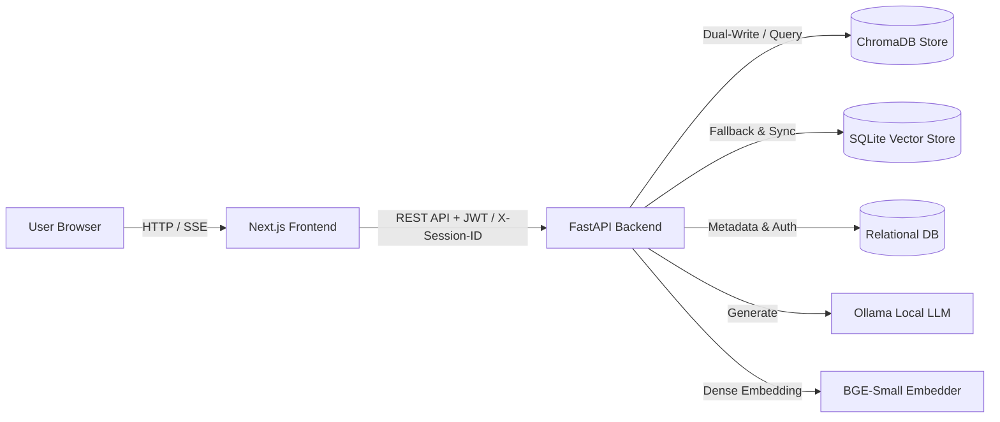

# 🧠 DocuMind AI

> **Chat with your documents. Get answers grounded in your own knowledge.**

DocuMind AI is a fully local, privacy-first document intelligence platform. Upload your PDFs and have natural, grounded conversations powered by a local LLM with verifiable source citations, JWT multi-user authentication, and strict guest session isolation.

---

## ✨ Features

- 📄 **Multi-document chat** — Query multiple PDFs simultaneously in a single conversation
- 🏠 **Local AI inference** — Powered by Ollama; no cloud, no API keys required
- 🔍 **Hybrid RAG pipeline** — Dense semantic search + Okapi BM25 lexical ranking with Reciprocal Rank Fusion (RRF)
- 💾 **Dual-Store Persistence** — ChromaDB primary vector storage with an ACID-compliant persistent SQLite fallback
- ⚡ **Streaming responses** — Real-time Server-Sent Events (SSE) token display with robust error isolation
- 📌 **Verifiable citations & deduplication** — Page-level and section-level references with semantic repetition filtering
- 🔒 **JWT Auth & Guest Session Isolation** — Complete multi-tenant privacy; guests and users cannot access each other's data
- 💬 **Persistent conversation history** — Auto-titled chats saved per user or guest session
- 📁 **Document management** — Upload, re-index, and delete PDFs with validated status tracking
- 🎨 **ChatGPT-like white-theme interface** — Clean, responsive sidebar with collapsible states and user initials

---

## 🛠 Technology Stack

| Layer | Technology |
|-------|-----------|
| **Frontend** | Next.js 16 (App Router), TypeScript, Tailwind CSS, Lucide Icons |
| **Backend** | Python 3.12, FastAPI, SQLAlchemy, SQLite / PostgreSQL |
| **AI Runtime** | Ollama (`qwen2.5:3b` default) |
| **Embeddings** | `BAAI/bge-small-en-v1.5`, sentence-transformers |
| **Vector DB** | ChromaDB with dual-write persistent SQLite fallback |
| **PDF Processing** | PyMuPDF (fitz) with typography & table extraction |

---

## 🏗 Architecture



---

## 📋 Prerequisites

| Requirement | Version |
|-------------|---------|
| **OS** | Windows 10/11, macOS, or Linux |
| **Python** | 3.11 or later |
| **Node.js** | 18 or later |
| **Ollama** | Latest ([ollama.ai](https://ollama.ai)) |
| **RAM** | 8 GB minimum (16 GB recommended) |

---

## 🚀 Installation & Running

### 1. Ollama Setup

```bash
ollama serve
ollama pull qwen2.5:3b
```

### 2. Backend Setup

```bash
cd backend
python -m venv venv
venv\Scripts\activate   # On Windows (or source venv/bin/activate on Linux/Mac)
pip install -r requirements.txt
copy .env.example .env  # On Windows (or cp .env.example .env)
uvicorn app.main:app --reload --host 0.0.0.0 --port 8000
```

### 3. Frontend Setup

```bash
cd frontend
npm install
npm run dev
```

Open [http://localhost:3000](http://localhost:3000) in your browser.

---

## 📡 API Endpoints

All endpoints support optional JWT authentication (`Authorization: Bearer <token>`) or guest sessions (`X-Session-ID: <session_id>`).

| Method | Endpoint | Description |
|--------|----------|-------------|
| `POST` | `/api/auth/register` | Create a new user account |
| `POST` | `/api/auth/login` | Authenticate and obtain JWT access token |
| `GET` | `/api/auth/me` | Get current authenticated user profile |
| `POST` | `/api/documents/upload` | Upload & index a PDF document |
| `GET` | `/api/documents` | List documents owned by user / guest session |
| `GET` | `/api/documents/{id}` | Get document metadata (ownership validated) |
| `DELETE` | `/api/documents/{id}` | Delete document and associated vector chunks |
| `POST` | `/api/chat/stream` | Stream RAG response via Server-Sent Events |
| `GET` | `/api/conversations` | List conversation history |
| `POST` | `/api/conversations` | Create a new conversation |
| `GET` | `/api/conversations/{id}` | Get conversation messages |
| `PATCH` | `/api/conversations/{id}` | Rename conversation title |
| `DELETE` | `/api/conversations/{id}` | Delete conversation |
| `GET` | `/api/health` | System and Ollama service health check |
| `GET` | `/api/settings` | Retrieve active system configuration |
| `GET` | `/api/models` | List locally installed Ollama models |

---

## 🧪 Testing

**Backend Test Suite:**
```bash
pytest backend/tests -v
```

**Frontend Test Suite:**
```bash
cd frontend
npm test
```

---

## 📄 License

This project is licensed under the **MIT License**.
