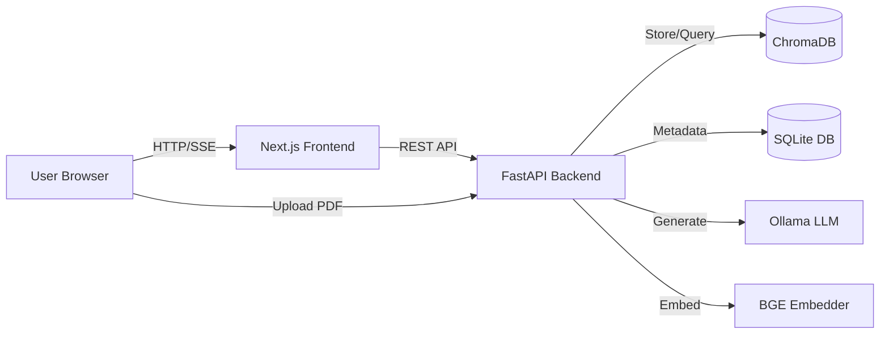

# 🧠 DocuMind AI

> **Chat with your documents. Get answers grounded in your own knowledge.**

DocuMind AI is a fully local, privacy-first document intelligence platform. Upload your PDFs and have natural, grounded conversations powered by a local LLM — no cloud, no API keys, no data leaving your machine.

---

## ✨ Features

- 📄 **Multi-document chat** — Query multiple PDFs simultaneously in a single conversation
- 🏠 **Local AI inference** — Powered by Ollama; no cloud, no API keys required
- 🔍 **Semantic RAG pipeline** — ChromaDB vector search retrieves the most relevant passages
- ⚡ **Streaming responses** — Real-time token display for a ChatGPT-like experience
- 📌 **Source citations** — Every answer includes page-level references to the source document
- 💬 **Persistent conversation history** — All chats are saved and resumable
- 📁 **Document management** — Upload and delete PDFs via the UI
- 🎯 **Multi-document selection** — Narrow queries to specific documents
- 🎨 **ChatGPT-like white-theme interface** — Clean, familiar, distraction-free

---

## 📸 Screenshots

> Screenshots coming soon — see the application running at http://localhost:3000

---

## 🛠 Technology Stack

| Layer | Technology |
|-------|-----------|
| **Frontend** | Next.js 14, TypeScript, Tailwind CSS, shadcn/ui |
| **Backend** | Python 3.11, FastAPI, SQLAlchemy, SQLite |
| **AI Runtime** | Ollama, `qwen2.5:3b` |
| **Embeddings** | `BAAI/bge-small-en-v1.5`, sentence-transformers |
| **Vector DB** | ChromaDB (persistent, local) |
| **PDF Processing** | PyMuPDF (fitz) |

---

## 🏗 Architecture



For a detailed breakdown, see [docs/architecture.md](docs/architecture.md).

---

## 🔎 RAG Pipeline

When you upload a PDF, DocuMind AI extracts text page-by-page, splits it into overlapping chunks, embeds each chunk with `BAAI/bge-small-en-v1.5`, and stores the vectors in ChromaDB. When you ask a question, the question is embedded and ChromaDB returns the most semantically similar chunks. Those chunks are injected into a carefully engineered prompt which is then streamed through Ollama's local LLM to produce a grounded, cited answer.

For full details, see [docs/rag-pipeline.md](docs/rag-pipeline.md).

---

## 📋 Prerequisites

| Requirement | Version |
|-------------|---------|
| **OS** | Windows 10 / Windows 11 |
| **Python** | 3.11 or later |
| **Node.js** | 18 or later |
| **npm** | bundled with Node.js |
| **Ollama** | Latest (download from [ollama.ai](https://ollama.ai)) |
| **RAM** | 16 GB recommended |
| **Free disk** | 10 GB (models + ChromaDB) |

---

## ⚙️ Ollama Setup

```bash
# 1. Install Ollama from https://ollama.ai

# 2. Pull the required model
ollama pull qwen2.5:3b

# 3. Start Ollama (usually starts automatically after install)
ollama serve
```

---

## 🚀 Installation

You need **three terminals** running simultaneously.

### Terminal 1 — Ollama

```bash
ollama serve
```

### Terminal 2 — Backend

```bash
cd "RAG ASSIGNMENT/backend"

# Create and activate virtual environment
python -m venv venv
venv\Scripts\activate

# Install dependencies
pip install -r requirements.txt

# Configure environment
copy .env.example .env

# Start the backend
uvicorn app.main:app --reload --host 0.0.0.0 --port 8000
```

### Terminal 3 — Frontend

```bash
cd "RAG ASSIGNMENT/frontend"

# Install dependencies
npm install

# Configure environment
copy .env.example .env.local

# Start the frontend
npm run dev
```

---

## 🔧 Environment Configuration

Backend `.env` variables (copy from `.env.example`):

| Variable | Default | Description |
|----------|---------|-------------|
| `OLLAMA_URL` | `http://localhost:11434` | Ollama server endpoint |
| `OLLAMA_MODEL` | `qwen2.5:3b` | LLM model to use for generation |
| `EMBEDDING_MODEL` | `BAAI/bge-small-en-v1.5` | Sentence-transformer embedding model |
| `CHROMA_PATH` | `./chroma_db` | Path to ChromaDB persistent storage |
| `STORAGE_PATH` | `./storage` | Path for uploaded PDF files |
| `DB_URL` | `sqlite:///./documind.db` | SQLAlchemy database connection string |
| `CHUNK_SIZE` | `2800` | Maximum characters per chunk (~700 tokens) |
| `CHUNK_OVERLAP` | `400` | Overlap between consecutive chunks (chars) |
| `TOP_K` | `5` | Number of chunks retrieved per query |
| `MAX_FILE_SIZE_MB` | `20` | Maximum upload file size in MB |
| `TEMPERATURE` | `0.1` | LLM sampling temperature |
| `MAX_TOKENS` | `2048` | Maximum tokens in LLM response |
| `CORS_ORIGINS` | `http://localhost:3000` | Allowed CORS origins |

---

## 🌐 Accessing the Application

| Service | URL |
|---------|-----|
| **Frontend UI** | http://localhost:3000 |
| **Backend API** | http://localhost:8000 |
| **Swagger / OpenAPI Docs** | http://localhost:8000/docs |
| **Ollama** | http://localhost:11434 |

---

## 🧪 Testing

**Backend tests:**

```bash
cd backend
venv\Scripts\activate
pytest tests/ -v
```

**Frontend tests:**

```bash
cd frontend
npm test
```

---

## 📡 API Overview

Full documentation is available in [docs/api-documentation.md](docs/api-documentation.md).

| Method | Endpoint | Description |
|--------|----------|-------------|
| `GET` | `/api/health` | Service health check |
| `POST` | `/api/documents/upload` | Upload a PDF document |
| `GET` | `/api/documents` | List all uploaded documents |
| `GET` | `/api/documents/{id}` | Get a single document by ID |
| `DELETE` | `/api/documents/{id}` | Delete a document and its vectors |
| `POST` | `/api/chat/stream` | Stream a chat response (SSE) |
| `GET` | `/api/conversations` | List all conversations |
| `POST` | `/api/conversations` | Create a new conversation |
| `GET` | `/api/conversations/{id}` | Get conversation with messages |
| `PATCH` | `/api/conversations/{id}` | Rename a conversation |
| `DELETE` | `/api/conversations/{id}` | Delete a conversation |
| `GET` | `/api/settings` | Get current app settings |
| `GET` | `/api/models` | List available Ollama models |

---

## ⚠️ Known Limitations

- **Image-only / scanned PDFs** are not supported — OCR is not included in this version
- Requires a **local Ollama installation** (no hosted fallback)
- **Performance depends on CPU speed** — a modern multi-core CPU is recommended
- **Large PDFs (100+ pages)** may take additional time to index on first upload
- The **embedding model loads into memory on the first request** — expect a short warm-up delay

---

## 🔮 Future Improvements

- [ ] OCR support for scanned and image-only PDFs
- [ ] Multiple embedding model options (configurable via UI)
- [ ] GPU acceleration for embedding and inference
- [ ] User authentication and multi-user support
- [ ] Export conversation history (PDF / Markdown)
- [ ] API rate limiting and abuse protection

---

## 📄 License

This project is licensed under the **MIT License**. See [LICENSE](LICENSE) for details.

---

<p align="center">Built with ❤️ using FastAPI, Next.js, ChromaDB, and Ollama</p>
