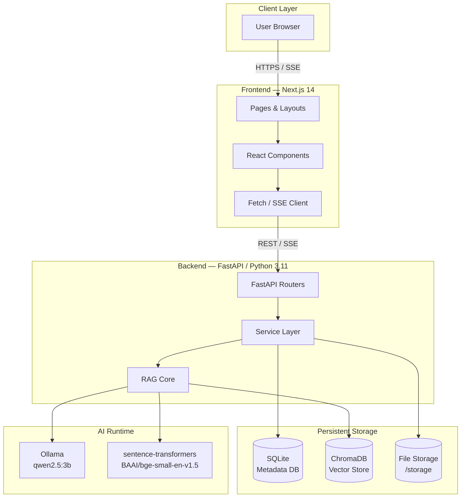
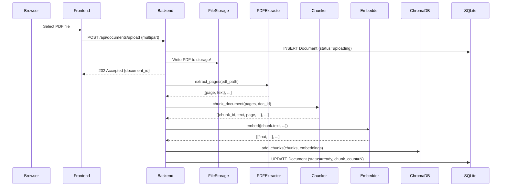
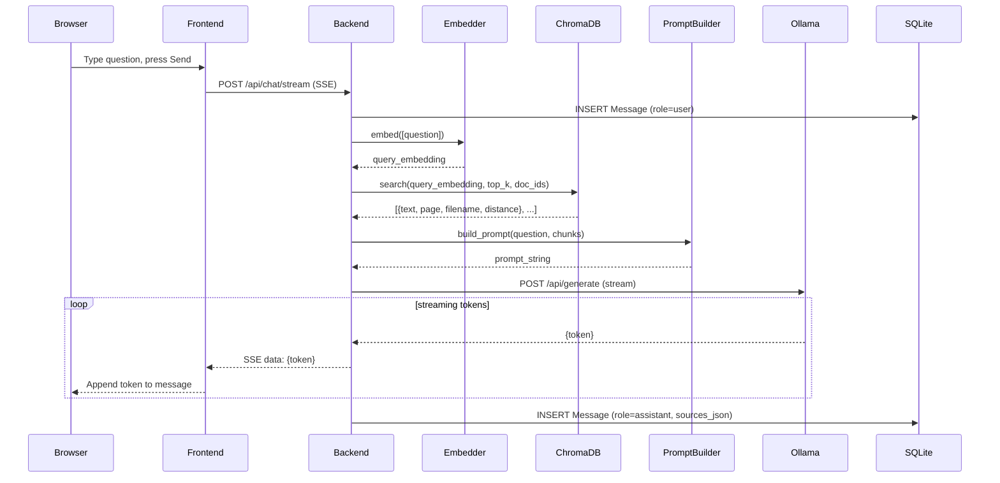

# DocuMind AI — System Architecture

This document describes the architecture of DocuMind AI: how its components are structured, how data flows through the system, and the key design decisions behind those choices.

---

## Table of Contents

1. [System Overview](#1-system-overview)
2. [Component Descriptions](#2-component-descriptions)
3. [Data Flow](#3-data-flow)
4. [Database Schema](#4-database-schema)
5. [Key Design Decisions](#5-key-design-decisions)

---

## 1. System Overview



DocuMind AI is a monorepo consisting of two independently deployable services:

| Service | Technology | Port |
|---------|-----------|------|
| **Frontend** | Next.js 14 (TypeScript) | 3000 |
| **Backend** | FastAPI (Python 3.11) | 8000 |

A third-party process — **Ollama** — runs separately and is called by the backend over HTTP on port 11434.

---

## 2. Component Descriptions

### 2.1 Frontend (Next.js 14)

The frontend is a React-based single-page application styled with Tailwind CSS and built with shadcn/ui component primitives. It communicates with the backend exclusively via REST (JSON) and Server-Sent Events (SSE) for streaming.

**Responsibilities:**
- Document upload UI (drag-and-drop or file picker)
- Document library with upload/delete controls
- Conversation sidebar (create, rename, delete)
- Chat window with streaming message display
- Document selector for per-query document scoping
- Source citation display (document name + page number)

### 2.2 Backend (FastAPI)

The backend is an async Python 3.11 application using FastAPI with SQLAlchemy 2.x for ORM and SQLite for relational metadata.

**Directory layout:**
```
backend/
  app/
    main.py          # Application entry point, CORS, router registration
    config.py        # Pydantic-settings environment config
    database.py      # SQLAlchemy engine, session factory, init_db()
    models/          # ORM models: Document, Conversation, Message
    schemas/         # Pydantic request/response schemas
    routers/         # FastAPI routers: documents, chat, conversations, settings, health
    services/        # Business logic: DocumentService, RAGService, OllamaService
    rag/             # RAG primitives: pdf_extractor, chunker, embedder, vector_store, prompt
  storage/           # Uploaded PDF files (binary)
  chroma_db/         # ChromaDB persistent data
  tests/             # pytest test suite
```

**Responsibilities:**
- Receiving multipart PDF uploads, writing them to `storage/`
- Orchestrating the document ingestion pipeline asynchronously
- Handling chat requests and streaming LLM tokens via SSE
- CRUD operations on Conversation and Message records
- Exposing the OpenAPI spec at `/docs`

### 2.3 RAG Pipeline

The RAG (Retrieval-Augmented Generation) pipeline is implemented in `app/rag/`. It has two sub-pipelines:

- **Ingestion** — converts uploaded PDFs to embedded, searchable chunks (see [rag-pipeline.md](rag-pipeline.md))
- **Query** — embeds the user's question, retrieves relevant chunks, and constructs a prompt for the LLM

### 2.4 ChromaDB

ChromaDB is a local, persistent vector database that stores chunk embeddings alongside metadata (document ID, filename, page number, chunk index). It is used exclusively by `rag/vector_store.py`.

| Property | Value |
|----------|-------|
| Client type | `PersistentClient` |
| Storage path | `./chroma_db` |
| Collection | `documind_documents` |
| Distance metric | L2 (Euclidean) |

### 2.5 SQLite (Metadata DB)

SQLite stores relational metadata via SQLAlchemy ORM. It is **not** used for vector search; that is ChromaDB's role. SQLite tracks document records, conversations, and message history.

### 2.6 Ollama

Ollama is a locally-running LLM inference server. The backend calls it over HTTP at `http://localhost:11434`. The default model is `qwen2.5:3b`, chosen for its balance of quality and performance on consumer hardware.

**Key call:**
```
POST http://localhost:11434/api/generate
{ "model": "qwen2.5:3b", "prompt": "...", "stream": true }
```

Tokens are streamed back as newline-delimited JSON objects and forwarded to the client as SSE events.

---

## 3. Data Flow

### 3.1 Document Upload Flow



### 3.2 Chat Query Flow



---

## 4. Database Schema

### Document

| Column | Type | Notes |
|--------|------|-------|
| `id` | String (UUID) | Primary key |
| `filename` | String | Sanitized storage filename |
| `original_filename` | String | User-uploaded filename |
| `stored_path` | String | Absolute path on disk |
| `file_hash` | String | SHA-256 of file content (indexed) |
| `file_size` | Integer | Bytes |
| `page_count` | Integer | Total pages in PDF |
| `chunk_count` | Integer | Total chunks stored (default 0) |
| `status` | String | `uploading` / `ready` / `error` |
| `error_message` | Text | Nullable; set on failure |
| `created_at` | DateTime | |
| `updated_at` | DateTime | |

### Conversation

| Column | Type | Notes |
|--------|------|-------|
| `id` | String (UUID) | Primary key |
| `title` | String | Display name |
| `created_at` | DateTime | |
| `updated_at` | DateTime | |

### Message

| Column | Type | Notes |
|--------|------|-------|
| `id` | String (UUID) | Primary key |
| `conversation_id` | String (FK) | References `Conversation.id`, cascade delete |
| `role` | String | `user` or `assistant` |
| `content` | Text | Full message text |
| `sources_json` | Text | Nullable JSON array of source citations |
| `created_at` | DateTime | |

**Indexes:** `Document.file_hash`, `Message.conversation_id`

---

## 5. Key Design Decisions

### 5.1 Fully Local Architecture

**Decision:** All AI inference (LLM + embeddings) runs locally.

**Rationale:** Privacy is the primary value proposition. Documents may contain sensitive information. By requiring Ollama and running sentence-transformers locally, no data ever leaves the user's machine. This also eliminates API costs and rate-limit concerns.

### 5.2 Page-Aware Chunking

**Decision:** Chunks never cross page boundaries.

**Rationale:** Page numbers are the most useful citation unit for document readers. Keeping chunks within a single page means every retrieved chunk has an unambiguous, correct page citation. Cross-page merging would require heuristics to attribute citations and would degrade citation accuracy.

### 5.3 SQLite + ChromaDB (Dual Storage)

**Decision:** Relational metadata in SQLite; vector data in ChromaDB.

**Rationale:** These stores are optimized for different access patterns. SQLite handles CRUD, joins, and ordered queries efficiently. ChromaDB handles nearest-neighbor vector search natively. Using a single store for both would require compromises in either query flexibility or search performance.

### 5.4 Server-Sent Events (SSE) for Streaming

**Decision:** Use SSE rather than WebSockets for LLM token streaming.

**Rationale:** SSE is unidirectional (server→client), which matches the LLM streaming pattern exactly. It is simpler to implement than WebSockets, works over standard HTTP, and is natively supported by browsers via the `EventSource` API. Full duplex is not needed here.

### 5.5 `qwen2.5:3b` as Default Model

**Decision:** Default to `qwen2.5:3b` via Ollama.

**Rationale:** At 3B parameters, `qwen2.5:3b` offers strong instruction-following and RAG suitability while fitting comfortably in RAM on typical consumer hardware (≥ 8 GB RAM) without a GPU. Users can swap in any Ollama-compatible model via the `OLLAMA_MODEL` env variable.

### 5.6 `BAAI/bge-small-en-v1.5` for Embeddings

**Decision:** Use `BAAI/bge-small-en-v1.5` as the embedding model.

**Rationale:** BGE-small-en-v1.5 delivers state-of-the-art retrieval quality for its size (33M parameters, 384-dim embeddings). It is fast enough to embed large PDFs in seconds on CPU, downloads once and runs locally, and consistently ranks highly on the MTEB retrieval benchmark.

---

*For the RAG pipeline deep-dive, see [rag-pipeline.md](rag-pipeline.md).*  
*For the API reference, see [api-documentation.md](api-documentation.md).*
