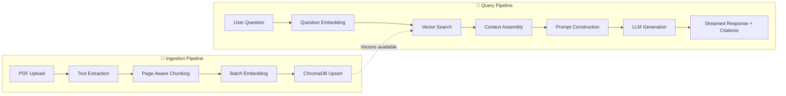
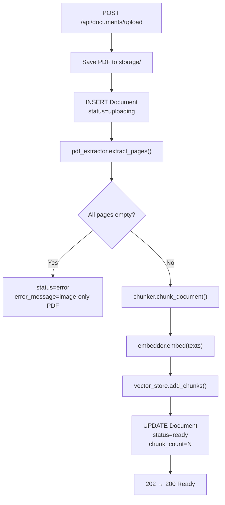
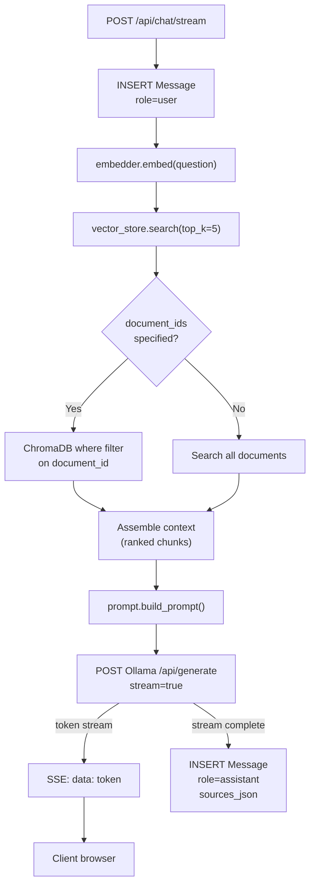

# DocuMind AI — RAG Pipeline

This document provides an in-depth explanation of DocuMind AI's Retrieval-Augmented Generation (RAG) pipeline: what it is, how it is implemented, and the design choices behind each stage.

---

## Table of Contents

1. [What is RAG and Why It Matters](#1-what-is-rag-and-why-it-matters)
2. [DocuMind AI's RAG Implementation](#2-documind-ais-rag-implementation)
3. [Document Ingestion Pipeline](#3-document-ingestion-pipeline)
4. [Query Pipeline](#4-query-pipeline)
5. [Chunking Strategy](#5-chunking-strategy)
6. [Embedding Model Choice](#6-embedding-model-choice)
7. [ChromaDB and Distance Metric](#7-chromadb-and-distance-metric)
8. [Prompt Engineering](#8-prompt-engineering)
9. [Context Budget Management](#9-context-budget-management)
10. [Known Limitations and Mitigations](#10-known-limitations-and-mitigations)

---

## 1. What is RAG and Why It Matters

Large Language Models (LLMs) like `qwen2.5:3b` are trained on general web data up to a fixed cutoff date. They have no knowledge of your private documents: internal reports, research papers, legal contracts, or anything you've written yourself. When asked about such content, they either refuse or hallucinate plausible-sounding but factually wrong answers.

**Retrieval-Augmented Generation (RAG)** solves this by giving the LLM access to your documents at query time. Instead of relying on parametric memory (learned weights), the model is provided with verbatim excerpts from your documents as part of its prompt. This produces answers that are:

- **Grounded** — the LLM can only say what the documents actually say
- **Citable** — every answer can point to the exact source passage and page
- **Up-to-date** — adding a new document immediately makes it queryable
- **Private** — no document content is ever sent to external servers

RAG is the standard architecture for document Q&A systems and enterprise knowledge bases.

---

## 2. DocuMind AI's RAG Implementation

DocuMind AI implements RAG in two sequential sub-pipelines:

| Sub-pipeline | Trigger | Output |
|-------------|---------|--------|
| **Ingestion** | PDF upload | Chunks + embeddings stored in ChromaDB |
| **Query** | User question | Streamed LLM answer + source citations |

The two pipelines share a single embedding model (`BAAI/bge-small-en-v1.5`) loaded as a process-wide singleton so the model is only loaded into memory once.



---

## 3. Document Ingestion Pipeline

### Stage 1 — PDF Text Extraction (`rag/pdf_extractor.py`)

The uploaded PDF is opened with **PyMuPDF** (`fitz`). Text is extracted page-by-page. Each page produces a dict: `{"page": int (1-based), "text": str}`.

- Empty pages (whitespace-only) are skipped.
- If **all** pages are empty, a `ValueError` is raised with the message `"PDF appears to be image-only; OCR is not available in this version"`. This is surfaced to the user as a `400 Bad Request`.

```python
import fitz  # PyMuPDF

def extract_pages(pdf_path: str) -> list[dict]:
    doc = fitz.open(pdf_path)
    pages = []
    for i, page in enumerate(doc):
        text = page.get_text().strip()
        if text:
            pages.append({"page": i + 1, "text": text})
    if not pages:
        raise ValueError("PDF appears to be image-only; OCR is not available in this version")
    return pages
```

### Stage 2 — Page-Aware Chunking (`rag/chunker.py`)

Each page's text is split into overlapping chunks using a character-level sliding window. Chunks **never cross page boundaries**. See [Section 5](#5-chunking-strategy) for the rationale.

Each chunk produces a metadata dict:

```python
{
    "chunk_id":     "sha256(doc_id:page:chunk_index)",
    "document_id":  "uuid",
    "filename":     "report.pdf",
    "page_number":  7,
    "chunk_index":  2,
    "text":         "...chunk text..."
}
```

The `chunk_id` is a SHA-256 hex digest of `"{document_id}:{page_number}:{chunk_index}"`. This makes chunk IDs deterministic — re-uploading the same file produces the same IDs, allowing ChromaDB upserts to be idempotent.

### Stage 3 — Batch Embedding (`rag/embedder.py`)

All chunks from the document are embedded in a single batch call to the sentence-transformer singleton. Batch embedding is significantly faster than embedding one chunk at a time due to GPU/CPU parallelism in the transformer model.

```python
embeddings = embedder.embed([chunk["text"] for chunk in chunks])
# Returns list[list[float]], one 384-dim vector per chunk
```

Embeddings are L2-normalized before storage (the model is loaded with `normalize_embeddings=True`).

### Stage 4 — ChromaDB Upsert (`rag/vector_store.py`)

Chunks and their embeddings are upserted into ChromaDB's `documind_documents` collection. Each entry has:

- **ID**: `chunk_id` (deterministic SHA-256)
- **Embedding**: 384-dimensional float vector
- **Document**: `{"text": "..."}` (the raw chunk text)
- **Metadata**: `{"document_id", "filename", "page_number", "chunk_index"}`

Using `upsert` (not `add`) means re-uploading a document updates existing chunks rather than creating duplicates.

After the upsert completes, the backend updates the Document record in SQLite: `status → "ready"`, `chunk_count → N`.

### Ingestion Flow Diagram



---

## 4. Query Pipeline

### Stage 1 — Question Embedding

The user's question string is embedded with the same singleton model used during ingestion. This ensures the embedding space is consistent.

```python
query_embedding = embedder.embed([question])[0]  # shape: (384,)
```

### Stage 2 — Vector Search

ChromaDB performs an approximate nearest-neighbour (ANN) search using **L2 (Euclidean) distance** over the stored chunk embeddings. If `document_ids` are specified in the request, a metadata `where` filter restricts the search to chunks from those documents only.

```python
results = vector_store.search(
    query_embedding=query_embedding,
    top_k=settings.TOP_K,          # default: 5
    document_ids=request.document_ids  # optional filter
)
```

Each result contains: `{text, document_id, filename, page_number, chunk_index, distance}`.

### Stage 3 — Context Assembly

Retrieved chunks are ranked by distance (closest first). They are assembled into a numbered context block for the prompt. If multiple chunks come from the same page, they appear together and share one citation.

### Stage 4 — Prompt Construction (`rag/prompt.py`)

A structured prompt is built from the question and context. See [Section 8](#8-prompt-engineering).

### Stage 5 — Streaming LLM Generation

The constructed prompt is sent to Ollama's `/api/generate` endpoint with `"stream": true`. The backend reads the newline-delimited JSON token stream and forwards each token as an SSE `data:` event to the connected client.

```
data: {"type": "token", "content": "The "}
data: {"type": "token", "content": "report "}
...
data: {"type": "sources", "sources": [...]}
data: {"type": "done"}
```

After streaming completes, the full assembled response and source citations are persisted as a `Message` record in SQLite.

### Query Flow Diagram



---

## 5. Chunking Strategy

### Configuration

| Parameter | Default | Description |
|-----------|---------|-------------|
| `CHUNK_SIZE` | 2800 chars | Maximum characters per chunk (~700 tokens at ~4 chars/token) |
| `CHUNK_OVERLAP` | 400 chars | Overlap between consecutive chunks (~100 tokens) |

### Why Character-Based, Not Token-Based?

Tokenization is model-specific and requires loading the tokenizer. Character-based splitting is fast, model-agnostic, and predictable. At 4 chars/token (English average), 2800 chars ≈ 700 tokens, comfortably within the context window for embedding (512 tokens for BGE-small) with graceful truncation behaviour from the model.

### Why Page-Aware (No Cross-Page Merging)?

1. **Citation accuracy**: Every chunk belongs to exactly one page. Citations are always correct.
2. **Semantic coherence**: PDF page boundaries usually reflect semantic breaks (sections, tables, figures).
3. **Simplicity**: No heuristics needed to split or attribute merged chunks.

If a page has very little text (fewer than `CHUNK_SIZE` characters), it becomes a single chunk with no splitting.

### Overlap

A 400-character overlap ensures that sentences or concepts near chunk boundaries are captured in at least one chunk. Without overlap, a question about a sentence that falls exactly at a chunk boundary might retrieve neither of the two adjacent chunks with high confidence.

---

## 6. Embedding Model Choice

**Model:** `BAAI/bge-small-en-v1.5`

| Property | Value |
|----------|-------|
| Parameters | 33 million |
| Embedding dimensions | 384 |
| Max input tokens | 512 |
| License | MIT |
| MTEB Retrieval (avg) | ~51.7 |

### Why BGE-Small-en-v1.5?

- **Retrieval-optimized**: BGE (BAAI General Embedding) models are fine-tuned specifically for retrieval tasks, not just semantic similarity.
- **Small footprint**: 33M parameters load in ~130 MB of RAM. Runs fast on CPU.
- **High quality for size**: BGE-small consistently outperforms much larger general-purpose sentence models on retrieval benchmarks.
- **Local**: Downloaded once from HuggingFace Hub and cached locally. No runtime API calls.
- **Normalized embeddings**: The model is loaded with normalization, enabling both cosine and L2 similarity (they are equivalent on normalized vectors).

### Singleton Pattern

The embedder is implemented as a process-wide singleton using `threading.Lock` to prevent concurrent model loads. The first request triggers loading (~2-3 seconds); subsequent requests reuse the loaded model.

---

## 7. ChromaDB and Distance Metric

**Client:** `chromadb.PersistentClient(path="./chroma_db")`  
**Collection:** `documind_documents`  
**Distance metric:** **L2 (Euclidean)**

Since embeddings are L2-normalized (‖v‖₂ = 1), L2 distance and cosine distance are mathematically equivalent:

```
L2(a, b)² = 2 - 2·cos(a, b)    when ‖a‖ = ‖b‖ = 1
```

Choosing L2 is the ChromaDB default and avoids any configuration overhead. Results with smaller L2 distance values are more semantically similar to the query.

**Distance threshold:** No hard threshold is applied. The top-k closest chunks are always returned, regardless of their absolute distance. This avoids returning empty results for unusual queries; the LLM is instructed to say "I don't know" if the context is irrelevant.

---

## 8. Prompt Engineering

The prompt is constructed in `rag/prompt.py`. It follows a system-instruction + context + question pattern designed for instruction-tuned chat models.

```
You are a helpful AI assistant that answers questions strictly based on the provided document context.
If the answer is not found in the context, say "I don't have enough information in the provided documents to answer that question."
Do not make up information. Always cite the page numbers where you found the information.

Context from documents:
---
[1] Source: annual_report_2024.pdf, Page 7
The revenue for fiscal year 2024 reached $4.2 billion, a 12% increase over...

[2] Source: annual_report_2024.pdf, Page 9
Operating expenses were reduced by 8% through the implementation of...
---

Question: What were the key financial highlights in 2024?

Answer:
```

### Design Choices

| Choice | Rationale |
|--------|-----------|
| "Strictly based on context" instruction | Reduces hallucination by anchoring the model |
| Explicit "I don't know" fallback | Prevents the model from fabricating answers when context is irrelevant |
| Numbered context blocks with source labels | Allows the model to reference `[1]`, `[2]` etc., and makes source attribution straightforward |
| Low temperature (0.1) | Prioritizes factual, deterministic output over creativity |

---

## 9. Context Budget Management

The LLM context window is finite. With `qwen2.5:3b`, the effective prompt budget is approximately 4096 tokens.

| Budget allocation | Tokens |
|-------------------|--------|
| System instruction | ~80 |
| Context (5 chunks × ~700 tokens) | ~3500 |
| Question | ~50 |
| Answer (`MAX_TOKENS`) | 2048 |
| **Total** | **~5678** (may exceed) |

In practice the context chunks are often shorter than the maximum, and the system instruction and question are small. If context exceeds the budget, chunks are truncated or fewer are retrieved (controlled by `TOP_K`). Future versions will implement dynamic context trimming based on actual token counts.

---

## 10. Known Limitations and Mitigations

| Limitation | Impact | Mitigation |
|-----------|--------|-----------|
| **Image-only / scanned PDFs** | Cannot extract text; upload fails with `400` | Inform user; future: add OCR (Tesseract/PaddleOCR) |
| **No cross-page chunk merging** | May miss context that spans two pages | Increase `CHUNK_OVERLAP` |
| **Fixed TOP_K** | May retrieve irrelevant chunks when documents are unrelated | Future: dynamic TOP_K or relevance threshold |
| **BGE-small max 512 tokens** | Chunks > 512 tokens are silently truncated by the model | `CHUNK_SIZE=2800 chars ≈ 700 tokens`; some truncation possible on dense text |
| **Single language (English)** | BGE-small-en is optimized for English | Use `BAAI/bge-m3` for multilingual support |
| **No re-ranking** | Retrieval order is ANN distance only; may not be optimal semantic rank | Future: add cross-encoder re-ranker |
| **Cold start latency** | First request loads the embedding model (~2-3s) | Pre-warm on startup; future: async model loading |
| **Context may exceed LLM window** | Very long retrieved chunks could overflow the prompt | Reduce `CHUNK_SIZE` or `TOP_K`; future: token-aware truncation |

---

*For the system architecture, see [architecture.md](architecture.md).*  
*For the API reference, see [api-documentation.md](api-documentation.md).*
